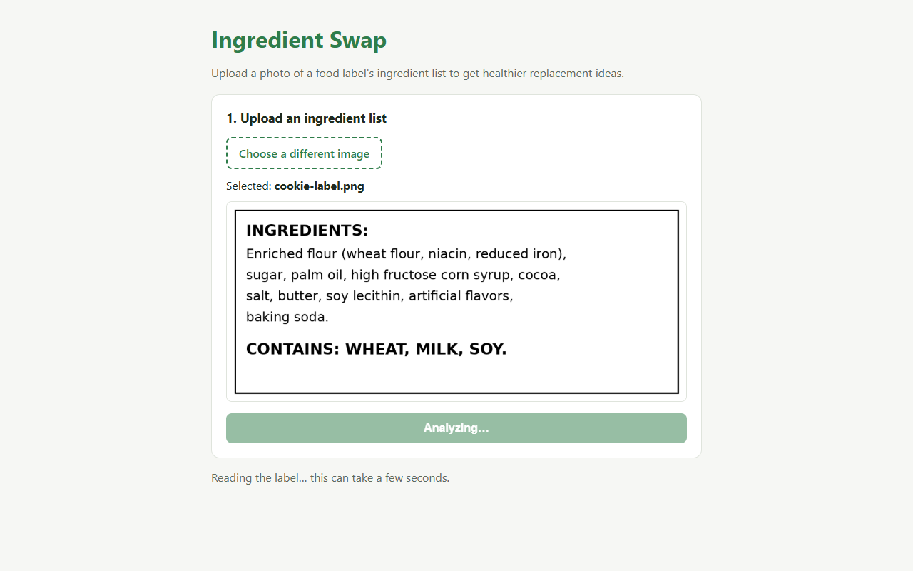
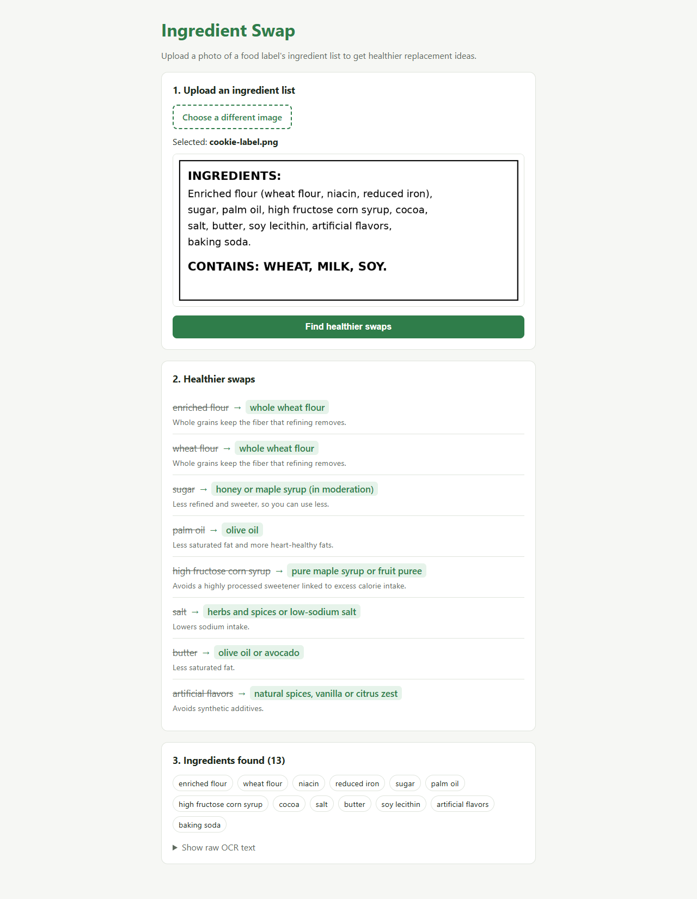

# Sprint A Evidence

Code tested: commit `2649ba1` (merge of PR #1 `sprint-a-implementation`). Sprint goal: *a user can upload a photo of an ingredient list and see healthier swaps, with no manual steps in between.*

Everything below was run on the Sprint A code as it was merged, not on the current `main`. Setup: Windows 11, Python 3.12, Tesseract 5.4.0, Node 22, Vite 7, Chrome (driven by Playwright).

How to reproduce:

```bash
git checkout 2649ba1
cd backend && pip install -r requirements.txt
uvicorn main:app --port 8000          # set TESSERACT_CMD if tesseract is not on PATH
cd ../frontend && npm install && npm run dev
# open http://localhost:5173 and upload sample-images/cookie-label.png
```

Sprint A had no automated test suite (tests were added in Sprint B). The checks below were run with a one-off API script and a browser script against the running app.

---

## #1122 Image Upload (Alejandro)

**What was built**
- `frontend/src/components/ImageUpload.jsx`: a "Choose an image" picker (`accept="image/*"`), the selected file name, an image preview, and a **Find healthier swaps** button.
- The button is disabled until a file is chosen and while a file is being analyzed.
- `App.jsx` rejects non-image files in the browser before anything is sent.
- `backend/main.py` checks the upload again on the server: file type, empty file, and the 10 MB limit.

**Browser results**

| Check | Result |
|---|---|
| Button disabled before a file is chosen | ✅ |
| File name shown after choosing (`Selected: cookie-label.png`) | ✅ |
| Image preview shown | ✅ |
| Picker text changes to "Choose a different image" | ✅ |
| `notes.txt` chosen → "Please choose an image file (PNG or JPG)." and button disabled | ✅ |

**Server results** (`POST /analyze`)

| Upload | Result |
|---|---|
| cookie-label.png | ✅ 200 |
| cookie-label.jpg (same label as JPEG) | ✅ 200, 8 swaps |
| notes.txt | ✅ 400 "Unsupported file type. Please upload a PNG, JPG, WEBP, BMP or TIFF image." |
| label.pdf | ✅ 400 (same message) |
| empty.png (0 bytes) | ✅ 400 "The uploaded file is empty." |
| 10 MB + 1 byte | ✅ 400 "The image is too large (max 10 MB)." |
| No file in the request | ✅ 422 |

**Screenshots:** [01 start page](sprint-a-evidence/01-start-page.png) · [02 image selected](sprint-a-evidence/02-image-selected.png) · [06 non-image error](sprint-a-evidence/06-non-image-error.png)

---

## #1123 Ingredient Text Extraction (Mohamed)

**What was built**
- `backend/ocr.py`: Tesseract OCR through `pytesseract`. Before reading, the image is turned upright using the phone's EXIF data, made grayscale, enlarged to at least 1000 px wide, and given auto-contrast.
- `backend/ingredient_parser.py` turns the raw text into a clean list:
  - keeps only the text after "Ingredients" and before "Contains:", "Allergen" and similar words
  - joins words split across lines ("hydro-\ngenated")
  - removes filler phrases such as "contains 2% or less of"
  - splits on commas, semicolons, periods and brackets, so sub-ingredients get their own entries
  - drops OCR noise and duplicates
- Damaged files and images with no text give clear errors instead of crashing.

**Result on `sample-images/cookie-label.png`** (0.9 s)

Raw OCR text, read exactly as printed:

```
INGREDIENTS:

Enriched flour (wheat flour, niacin, reduced iron),
sugar, palm oil, high fructose corn syrup, cocoa,
salt, butter, soy lecithin, artificial flavors,

baking soda.

CONTAINS: WHEAT, MILK, SOY.
```

Parsed list: **13 of 13 ingredients**, and the "Contains" allergen line is correctly left out:

`enriched flour`, `wheat flour`, `niacin`, `reduced iron`, `sugar`, `palm oil`, `high fructose corn syrup`, `cocoa`, `salt`, `butter`, `soy lecithin`, `artificial flavors`, `baking soda`

**Parser check** (text input, no OCR)

| Input | Output |
|---|---|
| `INGREDIENTS: Enriched flour (wheat flour, niacin), sugar,\npalm oil, hydro-\ngenated soybean oil, salt. CONTAINS: WHEAT.` | `enriched flour, wheat flour, niacin, sugar, palm oil, hydrogenated soybean oil, salt` |

**Error handling**

| Upload | Result |
|---|---|
| fake.png (text inside) | ✅ 422 "The file could not be read as an image." |
| blank white image | ✅ 422 "No text was found in the image. Try a clearer, well-lit photo of the ingredient list." |

**Screenshots:** [05 raw OCR text](sprint-a-evidence/05-raw-ocr-text.png) · [07 no text found](sprint-a-evidence/07-no-text-error.png)

---

## #1124 Ingredient Replacement Logic (Henry)

**What was built** (`backend/replacements.py`)
- A dictionary of **28 swaps** covering sweeteners, refined flour, fats and oils, salt, dairy, additives and artificial sweeteners. Each swap has a `replacement` and a short `reason`.
- `find_replacements()` matches **whole words only**, so "sugar" does not match "sugarcane fiber".
- It tries the **longest key first**, so "high fructose corn syrup" uses its own entry instead of "corn syrup".
- It gives one suggestion per ingredient. Each suggestion includes `original`, `matched`, `replacement` and `reason`.

**Matching check**

| Ingredient | Suggested replacement | Why |
|---|---|---|
| high fructose corn syrup | pure maple syrup or fruit puree | longest match wins over "corn syrup" |
| corn syrup | honey or fruit puree | |
| cane sugar | honey or maple syrup (in moderation) | whole word "sugar" inside a longer name |
| sea salt | herbs and spices or low-sodium salt | whole word "salt" |
| enriched flour | whole wheat flour | |
| palm oil | olive oil | |
| sugarcane fiber | *no swap* ✅ | "sugar" is only part of a word |
| buttermilk | *no swap* ✅ | "butter" is only part of a word |
| water | *no swap* ✅ | not in the list |

**On the sample label:** 8 of the 13 ingredients get a swap. The other 5 (niacin, reduced iron, cocoa, soy lecithin, baking soda) correctly get none.

---

## #1125 Display Swap Suggestions (Anthony)

**What was built** (`frontend/src/components/SwapResults.jsx`, `App.css`)
- **"2. Healthier swaps":** each swap is shown as *original (struck through) → replacement (green)*, with the reason underneath.
- **"3. Ingredients found (N)":** every parsed ingredient is shown as a chip.
- **"Show raw OCR text":** opens the exact text Tesseract read.
- If there are no swaps, or no ingredients, a friendly message says so.
- **Loading:** the button changes to "Analyzing…" and a "Reading the label… this can take a few seconds." message appears.
- **Errors** are shown in a red box under the upload card.

**Browser results**

| Check | Result |
|---|---|
| 8 swaps displayed | ✅ |
| Every swap shows original → replacement and a reason | ✅ |
| "Ingredients found (13)" with 13 chips | ✅ |
| Raw OCR text expands and shows the label text | ✅ |
| Loading message and disabled "Analyzing…" button while waiting | ✅ |
| No horizontal scroll at 1280 px or at 420 px (phone width) | ✅ |

**Screenshots**

| Loading | Results |
|---|---|
|  |  |

---

## #1121 End-to-End Integration & Demo (Ali)

**Integration**
- `backend/main.py` `POST /analyze` connects the steps: check the upload → `extract_text` → `parse_ingredients` → `find_replacements`. It returns `filename`, `extracted_text`, `ingredients` and `suggestions`.
- `frontend/src/api.js` sends the image as `multipart/form-data` to `http://127.0.0.1:8000`, which can be changed with `VITE_API_URL`. It turns FastAPI error details into readable messages.
- CORS allows the Vite dev server: `OPTIONS /analyze` from `http://localhost:5173` returns 200 with the matching `Access-Control-Allow-Origin`.
- `GET /` health check: `{"status": "ok", "message": "Ingredient Swap API is running"}`.

**Browser end-to-end run (21 checks, all passed)**
1. The page loads and the button is disabled before a file is chosen.
2. Choosing `cookie-label.png` shows its name and a preview, and enables the button.
3. Clicking **Find healthier swaps** shows the loading state, then 8 swaps and 13 ingredients, with no error.
4. The raw OCR text expands.
5. A `.txt` file is rejected in the browser, and the old results are cleared.
6. A blank image shows the server's "No text was found" message.
7. With the backend unreachable (the request was blocked in the browser), the page shows "Could not reach the backend at http://127.0.0.1:8000. Is uvicorn running?"
8. Analyzing again after all those errors works without reloading the page (8 swaps).
9. There is no horizontal scroll at 1280 px or at 420 px.

**Console and logs**
- Browser console: there were no JavaScript errors. The only entries were Chrome's automatic network messages for the deliberate 422 (blank image) and the blocked request, plus a 404 for `/favicon.ico` (Sprint A has no favicon).
- Backend log: no exceptions.

**Screenshots:** [08 backend unreachable](sprint-a-evidence/08-backend-unreachable.png) · all 8 are in [`sprint-a-evidence/`](sprint-a-evidence/)

---

## Known limits found later (fixed in Sprint B)

- **Harder photos were not read well:** sideways, blurry, shadowed or very small photos. On the six Sprint B test labels, Sprint A found 20 of 40 expected ingredients (50%). See [SPRINT_B_EVIDENCE.md #1204](SPRINT_B_EVIDENCE.md#1204-improve-ocr-accuracy-mohamed).
- **Some wrong matches:** "whole wheat flour" was swapped for whole wheat flour, "cocoa butter" for olive oil, and the broad `sodium` key matched sodium bicarbonate (baking soda) and sodium ascorbate (vitamin C). See [#1205](SPRINT_B_EVIDENCE.md#1205-expand-ingredient-replacement-database-henry).
- **Upload checks were basic:** the server trusted the browser-reported file type, and there was no drag and drop. See [#1207](SPRINT_B_EVIDENCE.md#1207-image-upload--validation-improvements-alejandro).
