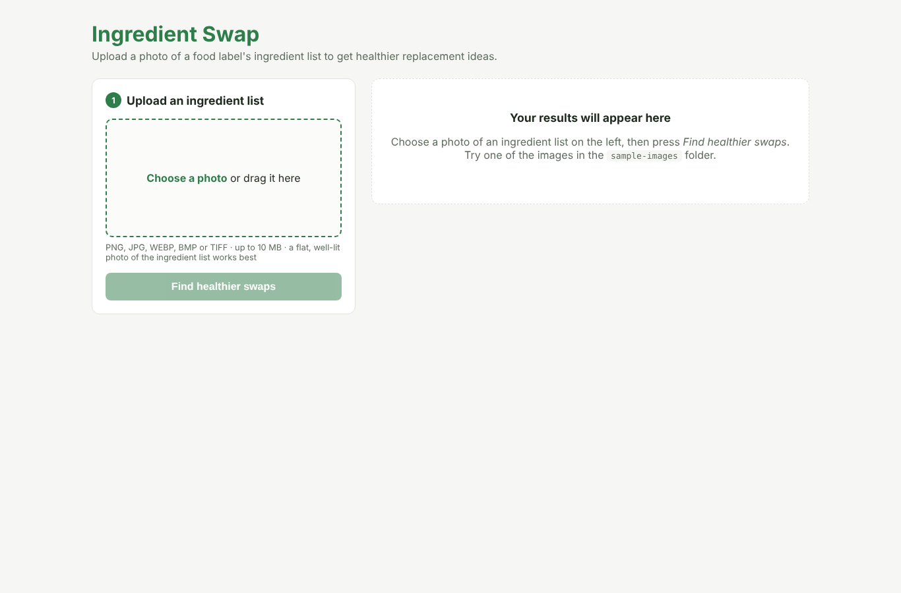
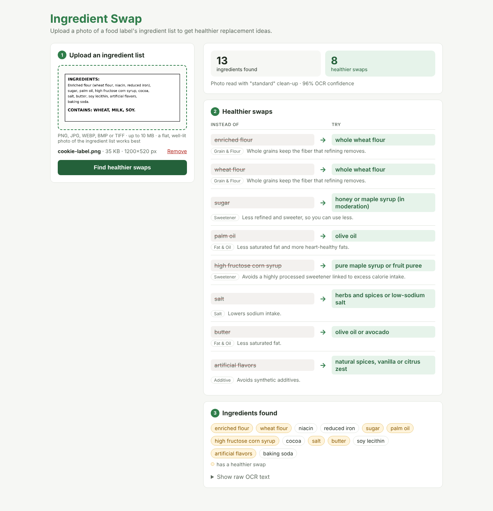
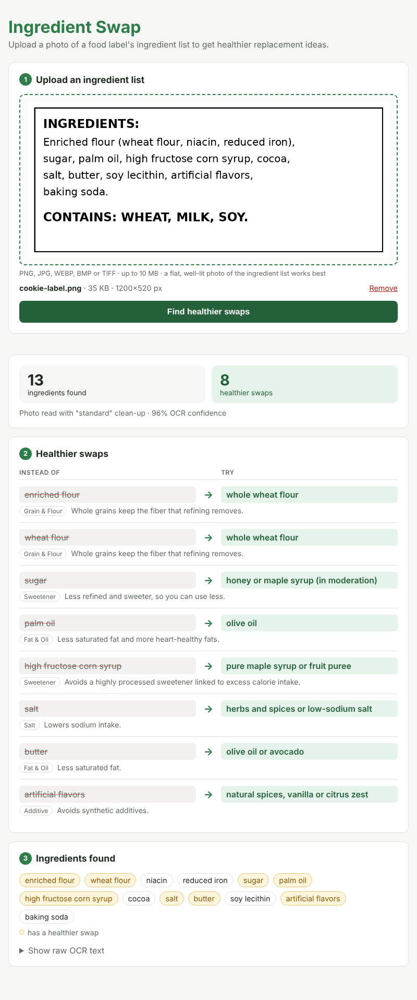

# Sprint B Evidence

Branch: `sprint-b-implementation` · Sprint goal: *users can get reliable healthier ingredient suggestions from a wider range of food-label images.*

How to reproduce everything below (from the repo root, with the backend virtualenv active):

```bash
cd backend
pip install -r requirements-dev.txt
python -m pytest -v          # 80 tests
python evaluate_ocr.py       # OCR accuracy table
```

The test images are in `sample-images/`. Run `python sample-images/generate_samples.py` to recreate the five hard ones.

---

## #1204 Improve OCR Accuracy (Mohamed)

**What changed** (`backend/ocr.py`, `backend/ingredient_parser.py`)

| Problem in real photos | Fix |
|---|---|
| Photo taken sideways | If the text reads badly, try 90°/180°/270° and keep the direction with the most confidently read words |
| Shadow / uneven lighting | "even lighting" clean-up: a heavy blur estimates the background lighting, which is subtracted so only the text remains |
| Blurry, noisy photo | "sharp black & white" clean-up: noise filter + sharpen + Otsu black/white threshold |
| Dark, low-contrast photo | Contrast stretch (kept from Sprint A), plus the two clean-ups above |
| Small / low-resolution photo | Enlarge until the longest side is 1600 px (Sprint A used width only, so tall photos were not enlarged) |
| Tesseract splitting the label into odd pieces | `--psm 6`: read the label as one block of text |
| Choosing between clean-ups | All three are tried. The one with the most words read at ≥70% confidence wins; on a tie the simplest wins, so clean labels behave as in Sprint A |
| OCR letter mistakes ("smortening") | `fix_ocr_typos()`: long unknown words that are ≥85% similar to a known ingredient word are corrected, and every correction is shown to the user |
| Parser bug: "contains 2% or less of" cut the list short | Filler phrases are removed before looking for "contains:" |
| Parser bug: OCR noise "caramel] color" split into two items | `[ ] { } \|` are now removed instead of treated as separators |

**Test images** (`sample-images/`)

| Image | What makes it hard |
|---|---|
| `cookie-label.png` | Clean (Sprint A image, unchanged) |
| `cereal-rotated.jpg` | Photo taken sideways (90°) |
| `granola-bar-dark.jpg` | Dark, low contrast, tilted 4° |
| `crackers-blurry-lowres.jpg` | Only 470×245 px, blurred, JPEG quality 30 |
| `soda-shadow-noisy.jpg` | Strong shadow across the label + camera noise |
| `pizza-white-on-dark.png` | White text on a dark background, condensed font |

**Before vs after.** Same six images; "expected found" = how many of the listed key ingredients appear in the parsed list.

| Image | Sprint A (main before this branch) | Sprint B |
|---|---|---|
| cookie-label.png (clean) | 7/7, 8 swaps | **7/7, 8 swaps** (unchanged) |
| cereal-rotated.jpg | 0/6, 0 swaps (read upside-down nonsense) | **6/6, 6 swaps** |
| granola-bar-dark.jpg | 6/7, 4 swaps | **7/7, 6 swaps** |
| crackers-blurry-lowres.jpg | 0/9, 0 swaps (no text at all) | **4/9, 5 swaps** |
| soda-shadow-noisy.jpg | 1/5, 2 swaps (shadowed half lost) | **5/5, 5 swaps** |
| pizza-white-on-dark.png | 6/6, 5 swaps | **6/6, 7 swaps** |
| **Total** | **20/40 (50%), 19 swaps** | **35/40 (88%), 37 swaps** |

(Sprint A swap counts use the Sprint A swap list, so they also reflect #1205.)

Full `python evaluate_ocr.py` output:

| Image | Difficulty | Expected found | Swaps | Clean-up used | Rotated | Confidence | Time |
|---|---|---|---|---|---|---|---|
| cookie-label.png | clean (Sprint A baseline) | 7/7 | 8 | standard | 0° | 96% | 1.0s |
| cereal-rotated.jpg | photo taken sideways (rotated 90 degrees) | 6/6 | 6 | standard | 270° | 95% | 1.7s |
| granola-bar-dark.jpg | dark, low-contrast photo with a slight tilt | 7/7 | 6 | standard | 0° | 92% | 0.9s |
| crackers-blurry-lowres.jpg | small, blurry, low-quality JPEG | 4/9 | 5 | standard | 0° | 59% | 0.9s |
|  | ↳ typo fixes: smortening → shortening, peprika extract → paprika extract; missed: enriched wheat flour, soybean oil, salt, monosodium glutamate, yellow 5 | | | | | | |
| soda-shadow-noisy.jpg | uneven lighting (shadow) and camera noise | 5/5 | 5 | even lighting | 0° | 96% | 1.3s |
| pizza-white-on-dark.png | white text on a dark background, condensed font | 6/6 | 7 | standard | 0° | 95% | 1.2s |

**Total: 35/40 expected ingredients found (88%)**

**Automated tests:** `tests/test_ocr_samples.py` (9 tests) runs every sample image and checks each one still meets its target. It also checks that the clean label gives exactly the Sprint A ingredient list, the sideways photo is turned, and the shadow photo uses "even lighting". `tests/test_parser.py` (8 tests) covers the parser bugs and typo fixing, including "must not change" cases (batter, sucrose, lactose…).

**Screenshots:** [03 rotated label](sprint-b-evidence/03-rotated-label-results.png) · [04 blurry label with warning and typo fixes](sprint-b-evidence/04-blurry-label-low-confidence.png) · [05 shadowed label](sprint-b-evidence/05-shadow-label-results.png)

---

## #1205 Expand Ingredient Replacement Database (Henry)

**What changed**
- The swap data moved from Python code to **`backend/data/replacements.json`**, so it can be edited without touching code. Each entry has `replacement`, `reason` and a new `category`.
- **28 → 63 swaps: 36 new.** The over-broad Sprint A key `sodium` was removed and replaced by specific sodium entries (see false positives below).
- A **`never_swap`** list stops matches that would be wrong.
- `backend/replacements.py` keeps the Sprint A rules: whole-word matching and longest match wins.

**New swaps (36)**

| # | Ingredient | Healthier replacement | Category |
|---|---|---|---|
| 1 | brown sugar | mashed banana or date paste | sweetener |
| 2 | brown rice syrup | date paste or a little maple syrup | sweetener |
| 3 | glucose syrup | fruit puree | sweetener |
| 4 | evaporated cane juice | fruit puree or less added sugar | sweetener |
| 5 | maltodextrin | whole grains or a fiber thickener like inulin | sweetener |
| 6 | acesulfame potassium | stevia or monk fruit | artificial sweetener |
| 7 | saccharin | stevia or monk fruit | artificial sweetener |
| 8 | enriched wheat flour | whole wheat flour | grain & flour |
| 9 | white rice flour | brown rice flour | grain & flour |
| 10 | potassium bromate | unbromated flour | grain & flour |
| 11 | palm kernel oil | olive oil | fat & oil |
| 12 | hydrogenated | olive oil or avocado oil | fat & oil |
| 13 | partially hydrogenated | olive oil or avocado oil | fat & oil |
| 14 | soybean oil | extra virgin olive oil | fat & oil |
| 15 | cottonseed oil | extra virgin olive oil | fat & oil |
| 16 | canola oil | extra virgin olive oil | fat & oil |
| 17 | lard | olive oil or avocado oil | fat & oil |
| 18 | cream cheese | Neufchatel or Greek yogurt cream cheese | dairy |
| 19 | cheddar cheese | reduced-fat cheddar | dairy |
| 20 | mozzarella cheese | part-skim mozzarella | dairy |
| 21 | white chocolate | dark chocolate (70%+ cocoa) | dairy |
| 22 | chocolate chips | dark chocolate chips (70%+ cocoa) | dairy |
| 23 | sodium benzoate | products preserved with vitamin C or vitamin E | preservative |
| 24 | sodium nitrite | uncured or nitrite-free meats | preservative |
| 25 | sodium nitrate | uncured or nitrate-free meats | preservative |
| 26 | bht | products preserved with vitamin E (mixed tocopherols) | preservative |
| 27 | bha | products preserved with vitamin E (mixed tocopherols) | preservative |
| 28 | tbhq | products preserved with vitamin E (mixed tocopherols) | preservative |
| 29 | caramel color | products without added coloring | color |
| 30 | red 40 | beet juice coloring | color |
| 31 | yellow 5 | turmeric or annatto coloring | color |
| 32 | yellow 6 | paprika or annatto coloring | color |
| 33 | blue 1 | spirulina extract coloring | color |
| 34 | titanium dioxide | products without whitening agents | color |
| 35 | phosphoric acid | sparkling water with lemon or lime | additive |
| 36 | carrageenan | products thickened with guar gum, or none | additive |

**False positives fixed** (each is a test in `tests/test_replacements.py`)

| Ingredient | Sprint A suggested | Sprint B |
|---|---|---|
| whole wheat flour | whole wheat flour (!) | no swap (already healthy) |
| cocoa butter | olive oil or avocado | no swap (not dairy butter) |
| peanut butter | olive oil or avocado | no swap |
| cream of tartar | Greek yogurt | no swap (a leavening agent) |
| sodium ascorbate (vitamin C) | herbs and spices | no swap |
| sodium bicarbonate (baking soda) | herbs and spices | no swap |
| sodium benzoate | herbs and spices | products preserved with vitamin C or E |
| partially hydrogenated soybean oil | *(missed)* | olive oil or avocado oil |

**Automated tests:** `tests/test_replacements.py` has 41 tests:
- at least 20 new keys exist
- every entry has a replacement, reason and category
- 22 "should match" cases, including the Sprint A ones and longest-match
- 14 "must not match" cases

---

## #1206 Improve Frontend UI & Results Display (Anthony)

**What changed** (`SwapResults.jsx`, `App.jsx`, `App.css`)
- **Layout:** two columns on laptop screens (upload on the left, which stays in view while scrolling; results on the right). Below 860 px it becomes one column.
- **Empty state** on the right before any upload, so the page never looks broken.
- **Loading:** spinner in the button plus a "Reading the label…" status card.
- **Errors:** red alert box with `role="alert"`.
- **Summary card:** "13 ingredients found / 8 healthier swaps", plus how the photo was read (clean-up used, rotation, OCR confidence).
- **Low-confidence warning** (below 70%) and a list of OCR typo fixes.
- **Swaps** as an "Instead of → Try" table: the original is grey and struck through, the replacement is green and bold, with the reason and a category badge underneath.
- **Ingredients found:** chips, with ones that have a swap highlighted in amber, plus a legend. The raw OCR text is still available under "Show raw OCR text".

**How it was tested:** browser end-to-end run (Chromium via Playwright) at 1366×900, 1280×800 and 800×1000. No horizontal scroll at any size, and no JavaScript errors.

**Screenshots**

| Start page | Clean label results | Narrow window |
|---|---|---|
|  |  |  |

---

## #1207 Image Upload & Validation Improvements (Alejandro)

**What changed**
- **Backend `validation.py`:** all upload checks are in one place, each with a plain-English message. This builds on PR #2 (real-format check, large-resolution handling) and adds:
  - file extension check
  - HEIC-specific message
  - file size shown in the "too large" message
  - minimum 50 px image size
  - clearer "damaged" message
  - all checks now reject bad files **before** OCR runs
- **Frontend `validation.js`:** the same checks run instantly in the browser (extension, type, HEIC, empty, damaged, too small, over 10 MB). It keeps PR #2's resize of photos larger than 4000 px.
- **`ImageUpload.jsx`:** drag & drop, accepted-types hint, file name + size + pixel dimensions ("resized for upload" when shrunk), and a Remove button. Picking the same file again after a rejection still works.

**Validation results**

| Upload | Browser | Server (API test) |
|---|---|---|
| notes.txt | ✅ blocked: '".txt" files are not supported…' | ✅ 400 |
| label.pdf | ✅ blocked | ✅ 400 |
| IMG_0001.HEIC | ✅ blocked: HEIC message with how to fix | ✅ 400 |
| text file named label.png | — | ✅ 400 Unsupported file type |
| GIF renamed to .png | — | ✅ 400 Unsupported file type |
| empty.png (0 bytes) | ✅ blocked: "This file is empty…" | ✅ 400 |
| fake.png (text inside) | ✅ blocked: "damaged or is not really an image" | ✅ 422 |
| tiny.png (30×20) | ✅ blocked: "too small to read (30x20 pixels)" | ✅ 422 |
| 10 MB + 1 byte | ✅ blocked | ✅ 400 |
| blank white image | sent to server | ✅ 422 "No text was found…" shown in UI |
| No file in request | — | ✅ 422 |
| **Valid:** PNG, JPG, WEBP, BMP, TIFF | ✅ accepted | ✅ 200 with swaps (all 5 formats tested) |
| **Valid:** all 6 sample images | ✅ accepted | ✅ 200 |

**Screenshots:** [06 unsupported file error](sprint-b-evidence/06-unsupported-file-error.png) · [07 no text found error](sprint-b-evidence/07-no-text-error.png)

---

## #1208 Sprint B Integration, Testing & Evidence (Ali)

**Integration**
- `main.py` wires the pieces together: `validate_upload` → `read_label` → `parse_ingredients` + `fix_ocr_typos` → `find_replacements`.
- The response keeps every Sprint A field and adds `category`, `ocr` and `corrections`, so older frontend code still works.
- `/analyze` is now a plain `def`, so the 1–2 s of OCR runs in a worker thread instead of blocking the server.
- The health endpoint shows the swap count, accepted file types and size limit.

**Automated backend tests: 80 passed**

| File | Tests | Covers |
|---|---|---|
| `tests/test_replacements.py` | 41 | #1205 data, matching, false positives |
| `tests/test_api.py` | 22 | #1207 every valid/invalid upload, health, CORS for both `localhost:5173` and `127.0.0.1:5173`, full `/analyze` on 5 samples, Sprint A response fields |
| `tests/test_ocr_samples.py` | 9 | #1204 accuracy per sample image, clean-label regression |
| `tests/test_parser.py` | 8 | parser bugs, OCR typo fixing |

**Browser end-to-end run (22 checks, all passed)**
- Empty state shows, and the analyze button is disabled before a file is chosen.
- All 6 sample images give results. Each one shows the loading state and its summary, and none shows an error.
- On the blurry image, the low-confidence warning and the typo fixes appear.
- Swap chips are highlighted, and the raw OCR text expands.
- 5 invalid files are rejected with the right message.
- The blank image shows the server's "No text was found" error.
- Remove, and drag & drop, both work.
- There's no horizontal scroll at 800 px or at 1280 px.
- With the backend stopped, the page shows "Could not reach the backend… Is uvicorn running?"
- **Console:** the only console entry was Chrome's automatic network log of the deliberate 422 from the blank-image test. There were no JavaScript errors, and the backend log showed no exceptions.

**Sprint A regression check**
- `cookie-label.png` gives the identical 13 ingredients and 8 swaps.
- All four Sprint A response fields are unchanged.
- The Sprint A swap keys still match (except the removed `sodium`).
- The PR #2 large-image handling is kept.

**How the testing was done:** the npm and PyPI registries were blocked in the build environment. FastAPI and httpx were loaded from their GitHub source, and the React code was bundled with esbuild instead of Vite, using the same source files. Tesseract 5.3.4 was used for OCR. Run `npm install && npm run dev` and `pip install -r requirements-dev.txt && python -m pytest` once locally to confirm.
